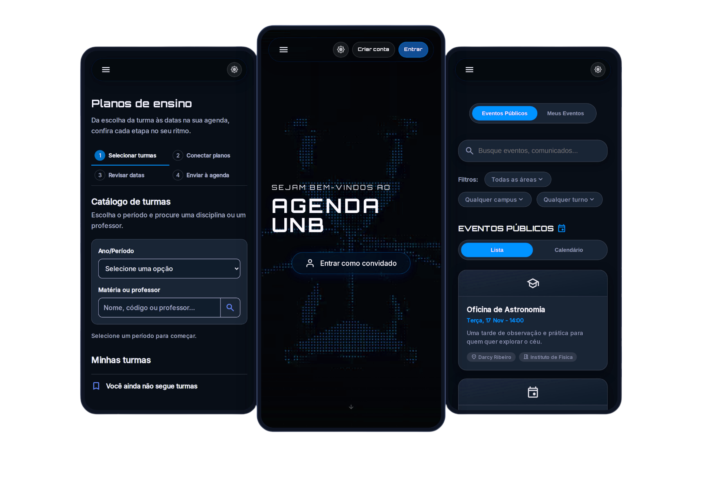

<p align="center">
  <!-- Banner principal no topo (equivalente ao logo do Flutter) -->
  
</p>

# **AGENDA UNB**

**Plataforma centralizada de eventos e organização acadêmica da Universidade de Brasília**

<p align="center">
  <a href="https://github.com/unb-mds/2026-2-AgendaUnB/actions">
    
  </a>
  <a href="https://unb-mds.github.io/2026-2-AgendaUnB">
    
  </a>
  <a href="https://github.com/unb-mds/2026-2-AgendaUnB/issues">
    
  </a>
  <a href="LICENSE">
    
  </a>
  <a href="https://www.unb.br/">
    
  </a>
</p>

O **AgendaUnb** é uma plataforma web colaborativa de eventos e organização acadêmica desenvolvida para os estudantes e docentes da **Universidade de Brasília (UnB)** centralizarem sua rotina em um único lugar. O sistema integra um catálogo público de eventos dos campi a um organizador acadêmico inteligente com extração automatizada de datas de planos de ensino, e é totalmente gratuito e de código aberto.

## Documentação

- [Instalar e executar o AgendaUnb](CONTRIBUTING.md#como-desenvolver)
- [Documentação oficial (MkDocs)](https://unb-mds.github.io/2026-2-AgendaUnB)
- [Arquitetura e modelo de dados](docs/Architecture.md)
- [Requisitos do sistema (21 RFs e 13 RNFs)](docs/requisitos.md)
- [Contribuindo com o AgendaUnb](CONTRIBUTING.md)

Acesse a aplicação em funcionamento em **[agendaunb.com.br](https://agendaunb.com.br)**, ou explore nossos protótipos e quadros de planejamento no **[Figma](https://www.figma.com/board/RlZe9FgO3Bz3gPkxevs8UJ/AGENDA-UNB?node-id=1-217)** e no **[Miro](https://miro.com/app/board/uXjVHtiWi4U=/)**. Nossa documentação também acompanha as [notas de release e sprints](docs/).

## Termos de uso e privacidade

O AgendaUnb utiliza autenticação via Google OAuth e e-mail institucional para identificar estudantes e docentes da Universidade de Brasília. Ao criar uma conta ou enviar planos de ensino para extração de datas:

- Apenas contas com domínio institucional `@unb.br` recebem automaticamente o perfil de docente (ou mediante atribuição administrativa).
- Eventos pessoais, planos de ensino enviados em PDF e candidatos a avaliações são isolados por políticas de *Row Level Security (RLS)* e armazenamento privado, sendo acessíveis exclusivamente ao próprio usuário proprietário.

## Sobre o AgendaUnb

A rotina de um estudante da UnB costuma estar fragmentada: a grade fica no SIGAA, as datas de provas estão espalhadas em PDFs de planos de ensino e os eventos acadêmicos e culturais circulam por Instagram, cartazes e grupos de WhatsApp. O AgendaUnb foi criado para reunir essas informações em uma única aplicação web produtiva, aberta e extensível.

### Experiências acadêmicas unificadas

Queremos permitir que cada estudante acompanhe a vida universitária e seus compromissos de estudo sem precisar alternar entre dezenas de portais. O AgendaUnb reúne dois eixos principais em uma interface responsiva (com temas claro e escuro):

- **Agenda do Campus:** Catálogo público de eventos acadêmicos, culturais e esportivos de todos os campi da UnB (**Darcy Ribeiro, FCTE, FCTS, FUP e FAL**), com visualização em lista ou calendário (mensal e semanal), filtros por área, campus e turno, além de salvamento na agenda pessoal e envio de sugestões com moderação.
- **Organizador Acadêmico:** Agenda pessoal privada integrada ao envio de planos de ensino (PDF ou texto bruto). O sistema processa o documento com Inteligência Artificial para identificar datas de provas, trabalhos e seminários, apresentando sugestões para revisão e confirmação humana antes de adicioná-las ao calendário.

<p align="center">
  <!-- Salve a imagem dos 3 celulares em formato PNG em assets/agendaunb-mobile.png -->
  
</p>

### Arquitetura moderna e resultados rápidos

O AgendaUnb foi estruturado com tecnologias modernas e gratuitas para garantir carregamento rápido, segurança de dados e facilidade de manutenção pela equipe:

| Camada | Tecnologia | Finalidade |
| :--- | :--- | :--- |
| **Frontend** | React 19, Vite 6, React Router 7 | SPA responsiva com temas claro/escuro e tipografia *Orbitron + Inter* |
| **Backend (API)** | Python 3, FastAPI, SQLAlchemy 2, Pydantic 2 | API REST com validação automática, moderação e extração com IA |
| **Banco de Dados** | PostgreSQL (Supabase) | Dados relacionais protegidos por *Row Level Security (RLS)* |
| **Autenticação e Storage** | Supabase Auth & Storage | Google OAuth, e-mail/senha, JWT e buckets privados por usuário |
| **Documentação e CI** | MkDocs Material & GitHub Actions | Site publicado no GitHub Pages e validação automática de migrações |

### Desenvolvimento produtivo e execução simplificada

O ambiente local do AgendaUnb utiliza **GNU Make**, **Supabase CLI** e **Docker**, permitindo que qualquer pessoa contribuidora suba o banco de dados, o backend e o frontend com poucos comandos e veja suas alterações em tempo real:

```bash
make setup
make dev
```

Para encerrar os serviços e parar os containers locais do Supabase, basta pressionar `Ctrl+C` e executar `make stop`. Veja o passo a passo completo no [guia de contribuição](CONTRIBUTING.md#como-desenvolver).

### Modelo aberto, seguro e extensível

O AgendaUnb funciona em qualquer ambiente de desenvolvimento (com suporte nativo a VS Code, Docker e Supabase CLI) e segue padrões rigorosos de segurança e qualidade: perfis criados automaticamente via *triggers*, moderação atômica de sugestões estudantis, isolamento de dados privados por usuário e integração contínua automatizada.

O AgendaUnb é um projeto totalmente de código aberto desenvolvido na disciplina de **Métodos de Desenvolvimento de Software (MDS)** da UnB, e damos as boas-vindas a novas contribuições. Informações sobre como começar podem ser encontradas no nosso [guia de contribuição](CONTRIBUTING.md) ou abrindo uma [issue no GitHub](https://github.com/unb-mds/2026-2-AgendaUnB/issues).

## Criadores

| <a href="https://github.com/thomas4ugust0"><br><sub><b>Thomas Araujo</b></sub></a><br>`FRONTEND` | <a href="https://github.com/heitormontt"><br><sub><b>Heitor Monteiro</b></sub></a><br>`BACKEND` | <a href="https://github.com/pontesluis"><br><sub><b>Luis Davi</b></sub></a><br>`BANCO DE DADOS` |
| :---: | :---: | :---: |
| <a href="https://github.com/Bielziin07"><br><sub><b>Gabriel Escramin</b></sub></a><br>`FRONTEND` | <a href="https://github.com/marrathomaz"><br><sub><b>Thomaz Marra</b></sub></a><br>`BACKEND` | <a href="https://github.com/felipecduque7"><br><sub><b>Felipe Duque</b></sub></a><br>`BANCO DE DADOS` |
