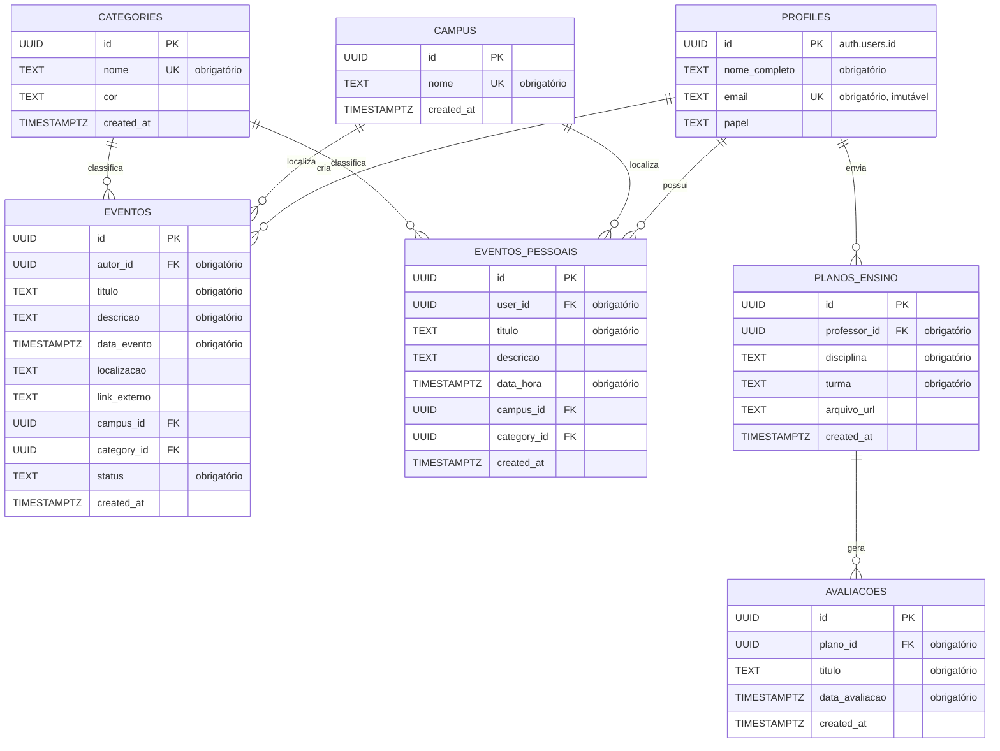

Este documento apresenta a estrutura visual de dados adotada no banco de dados Supabase do MVP da Agenda UnB. Ele inclui o Diagrama Entidade-Relacionamento (DER) para visualização da arquitetura, descrevendo como as tabelas interagem. O Dicionário de Dados detalhado (DDL) encontra-se no documento `/docs/arquitetura/banco-de-dados`.

---

## Diagrama Entidade-Relacionamento (DER)

O diagrama abaixo ilustra as relações entre as 7 tabelas que compõem o banco de dados.

---

