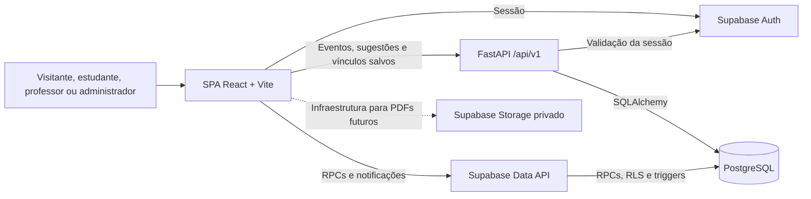
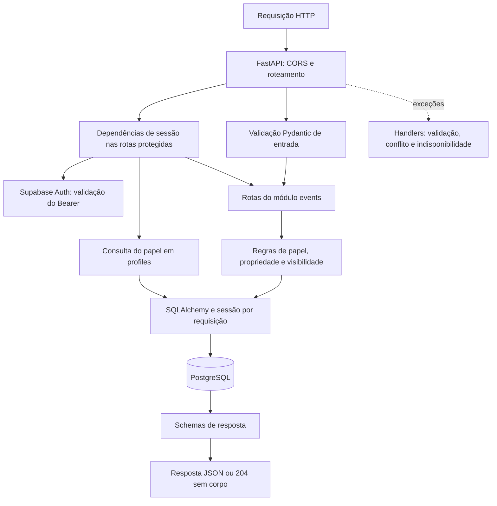

# Arquitetura de Software

## 1. Objetivo e escopo

O Agenda UnB reúne eventos públicos dos campi e compromissos privados em uma aplicação web responsiva. Não está previsto aplicativo nativo nem substituição do SIGAA para matrícula oficial, notas ou frequência. A importação futura de atestados usará PDFs enviados pelo estudante, sem integração direta com a API do SIGAA.

Referência da consolidação: **24/10/2026**, commit `e0ecf46`; histórico de operações comparado à tag `R1` (`4a3a07d`). Implementação observada e testes existentes não equivalem a aprovação formal do time. Propostas futuras são identificadas separadamente.

## 2. Visão geral

A comunicação tem dois caminhos: eventos, sugestões e agenda usam a API FastAPI; autenticação, RPCs de moderação/administração e notificações usam o SDK Supabase no navegador. As RPCs conferem o papel real no banco. A proteção das páginas React não substitui essa autorização.

## 3. Stack e organização

| Camada | Tecnologia e localização |
| --- | --- |
| Frontend | React 19, Vite 6, React Router 7; `frontend/src/` |
| API | Python, FastAPI, SQLAlchemy 2, Pydantic 2 e httpx; `backend/src/` |
| Dados e sessão | PostgreSQL via Supabase, Supabase Auth e SDK JavaScript |
| Migrações | 11 arquivos SQL em `supabase/migrations/`, aplicados em ordem de timestamp |
| Ambiente local | Supabase CLI e Docker; serviços coordenados pelo Makefile |
| Documentação | MkDocs Material, publicada no GitHub Pages pelo workflow de documentação |
| Testes | pytest em `backend/tests/`; testes de calendário via `node --test` |

A API é uma aplicação única, sem microsserviços. O módulo de eventos concentra rotas, schemas e regras dos eventos públicos, privados, salvos e sugestões. `database/models.py` mapeia as tabelas usadas pela API; as migrações SQL são a referência para o esquema completo, triggers, funções e políticas.

## 4. Frontend e navegação

| Rota | Comportamento |
| --- | --- |
| `/` | Apresentação, cadastro e login |
| `/eventos` | Catálogo público e Meus Eventos; lista de cards ou calendário mensal/semanal |
| `/evento/:id` | Detalhes de evento público aprovado ou compromisso privado do proprietário |
| `/plano-de-ensino` | Página informativa: importação ainda em preparação; oferece acesso à agenda manual |
| `/sugestoes` | Fila e histórico de sugestões; professores e administradores |
| `/admin` | Busca e filtros de usuários, confirmação de e-mail, último acesso e cargos; somente admins |
| `/segunda-pagina` | Redirecionamento legado para `/eventos`, preservando query e fragmento; `#plano-de-ensino` leva à página de planos |

O calendário usa os mesmos eventos filtrados da lista, com navegação por mês/semana, botão Hoje e horários ordenados por dia. As datas civis seguem o fuso local do navegador. Em telas pequenas, a grade permite rolagem horizontal.

Meus Eventos combina compromissos privados com vínculos a eventos públicos salvos. Os dados do público são lidos do original; remover o vínculo não altera o evento. Somente os compromissos privados podem ser editados nessa agenda.

## 5. API REST implementada

As rotas de negócio usam `/api/v1`; a sessão é enviada em `Authorization: Bearer <token>`. O backend valida o token com Supabase Auth e consulta o perfil no banco.

A referência única dos contratos é [api-specs.md](api-specs.md): 15 operações atuais, das quais 10 existiam na R1. Abrange catálogo público, CRUD privado, sugestões, vínculos salvos e saúde, com payloads, filtros, exemplos e erros por operação. Não há edição pública, upload ou rotas FastAPI administrativas implementadas.

PUT e DELETE dos vínculos salvos são idempotentes. O frontend percorre as páginas do catálogo em lotes de 100. Filtros de turno são aplicados na interface.

### Fluxo interno do backend

O diagrama representa responsabilidades, não uma ordem estrita de execução das dependências FastAPI. Rotas públicas dispensam a validação de sessão. `get_db` abre e fecha a sessão; as rotas controlam commits. Não existe camada separada de serviços/repositórios: regras e consultas estão concentradas no router. A consulta de papel e as regras de propriedade continuam necessárias mesmo quando a conexão PostgreSQL ignora RLS.

## 6. Sugestões, moderação e administração

O estudante escolhe **Sugerir evento** no formulário Criar Evento. `POST /api/v1/suggestions` persiste a proposta pendente. O banco força o status para autoria estudantil e registra `sugestao_estudante`, preservando essa origem mesmo após mudança de cargo.

O frontend chama as seguintes RPCs pelo SDK Supabase, sem endpoints FastAPI `/admin`:

| RPC | Responsabilidade e acesso |
| --- | --- |
| `listar_sugestoes` | Pendentes e histórico aprovado/rejeitado, busca e paginação de 20; professor/admin |
| `moderar_sugestao` | Decide somente sugestões pendentes; professor/admin; recusa exige justificativa de até 2.000 caracteres |
| `admin_buscar_usuarios` | Busca por nome/e-mail, filtros de papel e confirmação, último acesso e paginação de 20; admin |
| `admin_definir_papel` | Verifica cargo anterior e chama `admin_alterar_papel`; somente admin |

Decisões concorrentes de moderação não sobrescrevem uma decisão anterior. Mudanças de cargo detectam divergência do papel esperado, e um administrador não pode remover o próprio cargo de admin.

Triggers registram notificações de submissão, aprovação e recusa na mesma transação do evento. A tabela `notificacoes` guarda título e justificativa; o sino dos estudantes consulta ao enviar sugestão, ao voltar à janela e a cada 30 segundos. A leitura e a marcação como lida são limitadas ao destinatário por RLS e permissões de coluna. Esses avisos não são lembretes de proximidade.

## 7. Persistência, privacidade e migrações

As tabelas da base R1 são `profiles`, `campus`, `categories`, `eventos`, `eventos_pessoais`, `planos_ensino` e `avaliacoes`. As novas migrações adicionam `eventos_salvos`, `notificacoes`, campos de sugestões/recusa e contador de interessados, funções administrativas e políticas de Storage. A criação das estruturas de planos e avaliações não comprova a existência do parser.

- Eventos privados e vínculos salvos são limitados ao dono. A API também verifica propriedade, pois conexões administrativas podem ignorar RLS.
- Apenas eventos aprovados aparecem no catálogo e nas consultas de públicos salvos. A exclusão de um público remove seus vínculos em cascata.
- Cadastro e autopromoção para professor exigem `@unb.br`. A migração `20261018000100` removeu a constraint global de domínio: administradores podem atribuir professor a outro endereço pela RPC protegida. E-mail do perfil continua imutável.
- A alteração de papéis pelo navegador é protegida por trigger; não há cadastro livre como admin.
- O bucket privado `syllabus_files` aceita PDF até 10 MB. As políticas exigem a pasta `<user_id>/<arquivo>.pdf` e restringem envio/leitura ao dono. Chaves de serviço nunca devem ser expostas em variáveis `VITE_`.
- HTTPS é requisito de produção; `.env` guarda configurações locais fora do versionamento.

As migrações devem ser aplicadas antes de disponibilizar API/frontend dependentes delas. No Supabase local iniciado, use `npx supabase migration up --local`. `make db-reset` recria o banco com migrações e seed; não é o procedimento para preservar dados existentes. Veja os guias de [eventos salvos](eventos-salvos.md) e [painel](painel-administrativo.md).

## 8. Funcionalidades futuras e implantação

Continuam planejados: upload e extração de planos de ensino/atestados, vínculo automático com turmas, validação colaborativa, revisão individual, inscrições/cancelamentos, histórico de participação, lembretes de proximidade, exportação `.ics` e coleta externa. As rotas propostas em [Padrões](padroes.md) não são endpoints disponíveis.

O Modelo Dual prevê planos oficiais de professores com confirmação por colegas de turma e planos particulares revisados pelo estudante antes de salvar datas privadas. O parser deve priorizar PDF com texto selecionável e oferecer tratamento recuperável para arquivos ilegíveis. Estratégia de processamento, serviço de e-mail e fontes/frequência da coleta ainda precisam de definição. A hospedagem tem proposta documentada, pendente de adoção e implantação. O Storage privado já tem migração, mas o fluxo de upload e o processamento não estão implementados na aplicação.

O GitHub Pages hospeda a documentação. Isso não define hospedagem da SPA ou da API. O arquivo `backend/Dockerfile` está vazio; não constitui uma imagem executável. O desenvolvimento usa Supabase CLI/Docker, FastAPI e Vite. O [plano de implantação](implantacao.md) propõe Vercel, Render com runtime Python e Supabase separado por ambiente; não há pipeline da aplicação implementado.

## 9. Verificação

Execute pytest no backend, `npm run build` no frontend e `node --test src/lib/calendar.test.js` na pasta frontend. Os testes de API de eventos salvos usam SQLite e não validam políticas RLS reais. Os testes de moderação no PostgreSQL exigem `TEST_SUPABASE_DB_URL` apontando ao Supabase local; sem essa variável são ignorados. Consulte [Contribuição](CONTRIBUTING.md) para os comandos.

### Registro de validação — 24/10/2026

| Verificação executada | Resultado e limite |
| --- | --- |
| `python -m pytest tests -q` no backend | 15 passaram, 7 ignorados por ausência de Supabase local configurado; aviso de depreciação Starlette/httpx |
| `node --test src/lib/calendar.test.js` no frontend | 3 passaram |
| `npm run build` no frontend | Passou; aviso de chunk acima de 500 kB |
| OpenAPI × inventário documental | 15 operações encontradas; nenhuma ausente na especificação |
| Requisição pessoal com `starts_at` sem fuso, via TestClient | Reproduzido 500 no handler de validação; dívida registrada, código não alterado |
| `python -m mkdocs build --strict` | Passou; saída temporária fora do repositório |
| Inspeção visual do site local | Diagramas geral e interno renderizados; páginas de contratos e implantação revisadas |

Não foram executados testes RLS/RPCs em banco remoto, deploy nem homologação hospedada. Os sete testes ignorados permanecem pendentes de Supabase local descartável. O teste isolado do erro de validação usa entrada fictícia e não grava dados.

## 10. Registro de decisões arquiteturais

Registros retrospectivos do código, sem atribuir motivos históricos ou aprovação não documentados. As consequências são uma análise técnica do estado observado. Novas decisões devem registrar data, autoria/revisão e substituições.

| ID / estado | Contexto e solução observada | Consequências | Evidência |
| --- | --- | --- | --- |
| DA-01 — implementada | API pequena em aplicação única FastAPI, com módulo `events` concentrando rotas, schemas e regras | Operação simples; crescimento do router pode exigir separação futura | `backend/src/main.py`, `backend/src/modules/events/router.py` |
| DA-02 — implementada | Interface usa FastAPI para eventos e Supabase diretamente para Auth, RPCs, perfis e notificações | Dois caminhos de integração; autorização deve existir no backend e nas políticas/funções SQL | `frontend/src/lib/api.js`, `frontend/src/lib/moderation.js`, `frontend/src/contexts/AuthContext.jsx` |
| DA-03 — implementada | Bearer validado por chamada ao Auth; papel lido no banco | Depende da disponibilidade do Auth; timeout de 5 segundos; indisponibilidade resulta em 503 | `backend/src/middlewares/auth.py` |
| DA-04 — implementada | Papel para ações públicas; propriedade para privados/salvos; RLS e RPCs para acesso pelo SDK | Guards de UI não são segurança; conexão administrativa exige filtros explícitos na API | Router, middleware e migrações RLS |
| DA-05 — implementada | SQL versionado é referência do schema completo | ORM não documenta todas as tabelas, triggers ou políticas; migrações precedem código dependente | `supabase/migrations/`, `backend/src/database/models.py` |
| DA-06 — implementada | Agenda combina registros privados e vínculos a públicos | Salvar não duplica dados nem equivale a inscrição; exclusão pública remove vínculos | Migração `20261016000000`, router e `frontend/src/lib/api.js` |
| DA-07 — proposta | Hospedar SPA/API separadamente e isolar dados por ambiente | Requer configuração de CORS, Auth, segredos e promoção coordenada | [Implantação](implantacao.md) |

## 11. Matriz de regras e evidências

“Cobertura existente” significa cenário presente na suíte, não certificação de execução, homologação hospedada ou aprovação de negócio. A execução desta consolidação é registrada na seção 9. Arquivos de testes abaixo são relativos a `backend/tests/`.

| Regra implementada | Onde é aplicada | Cobertura existente / limite |
| --- | --- | --- |
| Catálogo e salvos exibem somente aprovados | Consultas do router | `test_events_api.py::test_list_public_events_filters_and_hides_pending`; `test_saved_events_api.py::test_unapproved_missing_and_deleted_events` |
| Privados são acessíveis somente pelo dono | Filtro `user_id` na API e RLS SQL | `test_events_api.py::test_personal_event_crud_is_limited_to_its_owner`; SQLite não comprova RLS |
| Só professor/admin publicam e excluem públicos | `require_event_manager` | `test_events_api.py::test_public_create_and_delete_require_event_manager`; sessão substituída no teste |
| Sugestão estudantil nasce pendente sem autoria/status forjados | Router e triggers SQL | `test_suggestions_api.py`; `test_moderation_database.py::test_student_rls_submission_and_notifications` |
| Moderação somente pendente; recusa justificada; avisos atômicos | `moderar_sugestao` e triggers | `test_moderation_database.py::test_moderation_and_atomic_notification`; execução PostgreSQL necessária |
| Notificações limitadas ao destinatário, atualização só de leitura | RLS e permissões de coluna | `test_moderation_database.py::test_student_rls_submission_and_notifications` |
| Admin altera terceiros, sem autorrebaixamento; detecta cargo divergente | `admin_definir_papel`, `admin_alterar_papel` | `test_moderation_database.py::test_admin_role_guards_and_professor_isolation`; concorrência simultânea não inferida desse teste |
| Cadastro/autopromoção professor exige domínio institucional; admin pode atribuir fora dele | Triggers e migração `20261018000100` | `test_moderation_database.py::test_admin_can_promote_personal_email_but_user_cannot` cobre promoção por admin; apesar do nome, não testa explicitamente todas as negativas de cadastro/autopromoção |
| Salvar/remover vínculo é idempotente e isolado por usuário | Router, chave composta e cascata | `test_saved_events_api.py`, incluindo duplicata e remoção própria; SQLite não comprova RLS |

Limites conhecidos: `location` pessoal não é persistido; o handler de validação pode falhar ao serializar certos contextos Pydantic; `/health` não verifica dependências. Os detalhes estão nos [contratos](api-specs.md). Corrigir essas limitações requer tarefas de código separadas desta consolidação.

## 12. Manutenção documental

Mudanças em rotas, schemas, autorização, regras de negócio, migrações e implantação devem atualizar o documento correspondente no mesmo PR. Contratos ficam em [API](api-specs.md), decisões nesta página, convenções em [Padrões](padroes.md) e operação em [Implantação](implantacao.md). Requisitos e notas de release preservam intenção e histórico; não substituem o contrato atual. Registrar evidências de testes e pendências sem declarar funcionalidades futuras como entregues.
