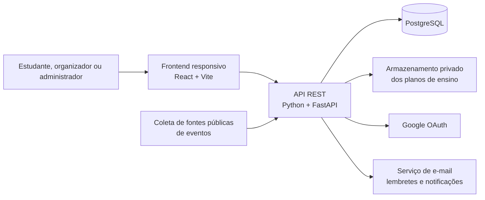

# Arquitetura de Software

Este documento registra a arquitetura para o Agenda UnB. Ele detalha como a aplicação pode evoluir a partir do frontend existente e dos requisitos em [`requisitos.md`](requisitos.md), seguindo os termos e as rotas definidos em [`padroes.md`](padroes.md).

## 1. Objetivo e escopo

A Agenda UnB reúne duas agendas que hoje ficam separadas: eventos públicos dos campi e compromissos acadêmicos privados dos estudantes. A aplicação deve permitir consultar eventos, organizar avaliações de turmas e, na evolução prevista, extrair datas de planos de ensino para revisão pelo estudante.

O produto é uma aplicação web responsiva. A interface para celular é a mesma aplicação web adaptada à tela; não está previsto um aplicativo nativo. A plataforma não substitui o SIGAA e não controla matrícula, notas ou frequência. Conforme o documento de visão, o estudante informa as próprias turmas, pois não há integração de matrícula com o SIGAA definida.

## 2. Visão geral

O frontend envia e recebe dados JSON pela API. A API aplica as regras de negócio, valida a identidade e as permissões do usuário, consulta ou atualiza o banco e coordena integrações externas. O banco guarda dados estruturados; os PDFs ficam em armazenamento de arquivos com acesso restrito, e o banco mantém os metadados e a referência ao arquivo.

Eventos públicos aprovados podem ser consultados sem login. A agenda pessoal, planos enviados, datas extraídas ainda não confirmadas e preferências do estudante exigem autenticação e verificação de propriedade. A coleta externa de eventos deve ser isolada: a indisponibilidade de uma fonte não pode impedir a consulta aos eventos já armazenados.

## 3. Stack consolidada

| Camada | Tecnologia | Uso previsto | Situação |
|---|---|---|---|
| Interface web | JavaScript, React 19, Vite 6 e React Router 7 | SPA responsiva; landing page, catálogo de eventos, formulários e detalhes | Em uso; implementado em `frontend/src/` com páginas `/`, `/segunda-pagina` e `/evento/:id` |
| Ferramentas do frontend | Node.js e npm | Instalar dependências, executar Vite em desenvolvimento e gerar os arquivos estáticos de produção | Em uso; build configurado via npm/Vite |
| API | Python 3.12, FastAPI, SQLAlchemy 2 e Pydantic 2 | Endpoints REST, validação de schemas, autorização e coordenação dos módulos | Em uso; implementado em `backend/src/` com suite de testes em `backend/tests/` |
| Persistência | PostgreSQL 15+ (via Supabase) | Dados relacionais de usuários, eventos públicos, eventos pessoais e referências | Em uso; banco gerenciado pelo Supabase com RLS ativo em todas as tabelas |
| Acesso ao banco | Supabase JS SDK (`@supabase/supabase-js`) e SQLAlchemy | Frontend acessa Auth e dados públicos via SDK; API Python acessa o PostgreSQL via SQLAlchemy | Em uso; SDK em `src/lib/supabase.js` e SQLAlchemy em `backend/src/database/` |
| Migrações | Supabase Migrations (SQL) | Versionar mudanças no esquema do banco com arquivos SQL em `supabase/migrations/` | Em uso; cinco migrações SQL aplicadas e versionadas |
| Ambiente local | Supabase CLI | Subir PostgreSQL, Auth, Storage e Studio localmente via `supabase start` (usa Docker internamente) | Em uso; `supabase/config.toml` configurado |
| Arquivos | Supabase Storage | Guardar PDFs de planos de ensino com controle de acesso privado | Em uso/configurado no `config.toml` |

O backend implementa o prefixo `/api/v1` para os recursos de negócio, desacoplado do frontend SPA. A comunicação utiliza tokens JWT gerados pelo Supabase Auth e validados pelo backend via middleware.

Docker é utilizado no ambiente de desenvolvimento local via Supabase CLI e para empacotar a API Python (`backend/Dockerfile`).

## 4. Componentes da aplicação

### 4.1 Frontend web

O frontend React apresenta a vitrine institucional, o catálogo público de eventos e, após autenticação, a gestão de compromissos privados. Funciona em computadores, tablets e smartphones por meio de layout responsivo e do Design System "The Neon Campus".

Responsabilidades principais:

- apresentar landing page com shaders WebGL em estilo halftone e apresentação do projeto;
- consultar eventos públicos por intervalo de datas, categoria, campus e turno com busca textual;
- gerenciar eventos pessoais do estudante (criar, editar e excluir compromissos privados);
- permitir autenticação via e-mail/senha, Google OAuth ou navegação anônima como visitante;
- apresentar tela dedicada de detalhes do evento (`/evento/:id`);
- suportar alternância global entre temas claro e escuro;
- preparar fluxos para upload de planos de ensino e revisão de datas extraídas (Release 2).

### 4.2 API e módulos de domínio

A API FastAPI expõe recursos HTTP JSON e separa entrada/saída HTTP das regras de negócio. Os controllers/routers recebem a requisição, verificam autenticação e permissão, validam os dados e chamam os serviços correspondentes. Os serviços aplicam regras e acessam repositórios ou integrações.

| Módulo | Responsabilidades |
|---|---|
| **Autenticação e governança** | Sessão via Supabase Auth, perfil e papéis `student`, `professor` e `admin`; alteração de cargos exclusiva para administradores |
| **Agenda e eventos** | Consultar eventos públicos, criar/editar eventos pessoais, filtros, inscrições e calendário unificado |
| **Submissão e moderação** | Receber propostas de eventos com status `pending`, permitir aprovação/rejeição por professores e administradores |
| **Turmas e Matrículas** | Processar upload de atestados de matrícula (PDF do SIGAA) para alocar automaticamente estudantes em suas disciplinas e turmas |
| **Planos de ensino (Modelo Dual)** | Receber planos oficiais (professores) e uploads particulares (estudantes), extrair datas e gerenciar validação colaborativa e individual |
| **Notificações e exportação** | Programar lembretes e gerar arquivo `.ics` para calendários externos |
| **Coleta de eventos** | Importar eventos de portais de notícias e canais institucionais da UnB (SIGAA e redes sociais condicionadas à viabilidade) |

Os módulos operam como componentes lógicos da API FastAPI única, mantendo o acoplamento baixo sem a complexidade operacional de microsserviços.

### 4.3 Processamento de planos e atestados de matrícula

O upload de documentos acadêmicos opera de forma assíncrona com os seguintes fluxos:

#### Fluxo 1: Atestado de Matrícula (Alocação Automática em Turmas)
1. O estudante envia o PDF do atestado de matrícula emitido pelo SIGAA (`POST /api/v1/enrollment/upload`).
2. O parser extrai códigos de disciplinas, nomes de matérias, turmas e professores.
3. O sistema cria ou vincula o estudante às respectivas turmas no banco relacional (`matriculas`), dispensando inserção manual.

#### Fluxo 2: Planos de Ensino — Modelo Dual
1. **Planos Oficiais de Turmas (Docentes):**
   - O professor envia o plano de ensino da disciplina.
   - O parser identifica as datas de avaliações, provas e trabalhos.
   - As avaliações são vinculadas à turma e ficam disponíveis para consulta dos matriculados.
   - **Validação Colaborativa Ativa:** Alunos da mesma turma podem confirmar ou contestar as datas sugeridas pelo parser.
2. **Uploads Particulares de Estudo (Estudantes):**
   - O estudante envia um plano de ensino diretamente para sua organização pessoal.
   - As datas extraídas passam por uma tela de revisão assistida ("Human-in-the-loop"), onde o discente pode editar ou descartar itens antes de salvá-los como compromissos privados na sua agenda.

## 5. Fluxos principais e rotas

A arquitetura organiza os endpoints REST da aplicação com prefixo `/api/v1`. Os fluxos abaixo separam o que foi **entregue na Release 1** do que está **planejado para a Release 2** e etapas seguintes:

### 5.1 Endpoints Implementados (Release 1)

| Fluxo | Método e Rota | Descrição e Acesso |
|---|---|---|
| Autenticação (Client SDK) | `Supabase Auth SDK` | Cadastro, login com senha e Google OAuth gerenciados no frontend com tokens JWT |
| Catálogo de eventos | `GET /api/v1/events` | Listagem pública com filtros (`campus`, `category`, `startDate`, `endDate`, `q`, `limit`, `offset`) |
| Detalhe de evento público | `GET /api/v1/events/{id}` | Consulta aberta aos detalhes do evento aprovado |
| Criar evento público | `POST /api/v1/events` | Criação restrita a `professor` e `admin`; nasce aprovado |
| Excluir evento público | `DELETE /api/v1/events/{id}` | Exclusão restrita a `professor` e `admin` |
| Listar eventos pessoais | `GET /api/v1/me/events` | Compromissos e prazos privados do usuário autenticado |
| Detalhe de evento pessoal | `GET /api/v1/me/events/{id}` | Consulta restrita ao proprietário (`user_id`) |
| Criar evento pessoal | `POST /api/v1/me/events` | Criação de compromisso na agenda particular |
| Atualizar evento pessoal | `PUT /api/v1/me/events/{id}` | Atualização restrita ao proprietário |
| Excluir evento pessoal | `DELETE /api/v1/me/events/{id}` | Exclusão restrita ao proprietário |
| Health check | `GET /health` | Verificação de disponibilidade da API |

### 5.2 Endpoints Planejados (Release 2 e Futuro)

| Fluxo | Rotas planejadas | Descrição e Permissões |
|---|---|---|
| Atestado de Matrícula | `POST /api/v1/enrollment/upload` | Envio de atestado do SIGAA e alocação automática em turmas |
| Planos de ensino | `POST /api/v1/syllabus/upload`, `GET /api/v1/syllabus` | Upload e acompanhamento no Modelo Dual (oficial docente e privado aluno) |
| Validação Colaborativa | `POST /api/v1/assessments/{id}/confirm` | Votação/confirmação de datas de avaliações por colegas de turma |
| Moderação de Eventos | `GET /api/v1/admin/events/pending`, `PATCH /api/v1/admin/events/{id}/review` | Visualização e aprovação de eventos por Professores e Admins |
| Gestão de Papéis | `PATCH /api/v1/admin/users/{id}/role` | Alteração de cargos (`student`, `professor`, `admin`) exclusiva para Admins |
| Inscrição em evento | `POST/DELETE /api/v1/events/{id}/attend` | Inscrição direta e cancelamento em eventos do campus |
| Categorias | `GET/POST /api/v1/categories` | Consulta e gestão de categorias de eventos |

O backend verifica autorização em cada operação através de middlewares (`get_current_user`, `require_event_manager`) e políticas de RLS no PostgreSQL, assegurando que nenhum dado acadêmico privado seja exposto.

## 6. Segurança, privacidade e confiabilidade

- Senhas locais, caso esse modo de autenticação seja aprovado, devem ser armazenadas como hash seguro; nunca em texto simples.
- Tokens e segredos de OAuth devem permanecer no servidor e fora do repositório. A restrição por domínio de e-mail precisa ser decidida antes de configurar Google OAuth.
- A API deve aplicar autorização por papel e por propriedade do recurso. Dados acadêmicos, arquivos e datas privadas não podem ser expostos em consultas públicas.
- PDFs devem ser armazenados em local privado, com validação de formato/tamanho e acesso autorizado. A API não deve publicar o caminho interno do arquivo.
- Comunicação externa em produção deve usar HTTPS. Erros de leitura de PDF ou indisponibilidade de fontes externas devem produzir estados recuperáveis e mensagens claras.
- A coleta externa deve ser desacoplada das consultas normais à agenda para que uma falha de scraping não interrompa o serviço.

## 7. Implantação e ambiente

O repositório publica a **documentação** com MkDocs pelo workflow `.github/workflows/docs.yml`. Isso não define onde a aplicação Agenda UnB será hospedada. A hospedagem da SPA, da API, do banco e dos arquivos continua em aberto.

No desenvolvimento, a proposta é executar a API Python e o PostgreSQL em containers Docker; o frontend continua usando npm/Vite. Arquivos `.env` locais devem guardar configurações e credenciais fora do controle de versão, usando `.env.example` apenas para documentar os nomes das variáveis necessárias.

## 8. Decisões pendentes e escopo

1. **Armazenamento e e-mail:** escolher provedores e definir como guardar PDFs e enviar notificações.
2. **Extração:** verificar se os planos de ensino têm texto selecionável; decidir se OCR é necessário. Definir também como datas ambíguas serão revisadas.
3. **Coleta de eventos:** escolher fontes públicas suportadas, frequência de atualização e tratamento de duplicatas. A coleta de redes sociais exige validação técnica e de disponibilidade das fontes.
4. **Prioridade do pré-MVP:** a visão prioriza primeiro autenticação, catálogo público e agenda de eventos; upload, extração automática, lembretes e exportação podem entrar em etapas posteriores.

Até essas decisões serem aprovadas, este documento deve ser lido como uma arquitetura de referência para discussão, e não como um registro de componentes já entregues.
