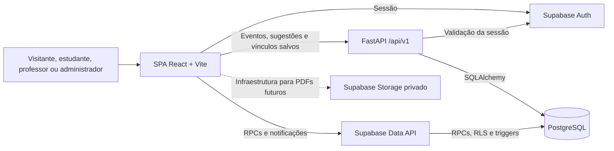

# Arquitetura de Software

## 1. Objetivo e escopo

O Agenda UnB reúne eventos públicos dos campi e compromissos privados em uma aplicação web responsiva. Não está previsto aplicativo nativo nem substituição do SIGAA para matrícula oficial, notas ou frequência. A importação futura de atestados usará PDFs enviados pelo estudante, sem integração direta com a API do SIGAA.

## 2. Visão geral

A comunicação tem dois caminhos: eventos, sugestões e agenda usam a API FastAPI; autenticação, RPCs de moderação/administração e notificações usam o SDK Supabase no navegador. As RPCs conferem o papel real no banco. A proteção das páginas React não substitui essa autorização.

## 3. Stack e organização

| Camada | Tecnologia e localização |
| --- | --- |
| Frontend | React 19, Vite 6, React Router 7; `frontend/src/` |
| API | Python, FastAPI, SQLAlchemy 2, Pydantic 2 e httpx; `backend/src/` |
| Dados e sessão | PostgreSQL via Supabase, Supabase Auth e SDK JavaScript |
| Migrações | 11 arquivos SQL em `supabase/migrations/`, aplicados em ordem de timestamp |
| Ambiente local | Supabase CLI e Docker; serviços coordenados pelo Makefile |
| Documentação | MkDocs Material, publicada no GitHub Pages pelo workflow de documentação |
| Testes | pytest em `backend/tests/`; testes de calendário via `node --test` |

A API é uma aplicação única, sem microsserviços. O módulo de eventos concentra rotas, schemas e regras dos eventos públicos, privados, salvos e sugestões. `database/models.py` mapeia as tabelas usadas pela API; as migrações SQL são a referência para o esquema completo, triggers, funções e políticas.

## 4. Frontend e navegação

| Rota | Comportamento |
| --- | --- |
| `/` | Apresentação, cadastro e login |
| `/eventos` | Catálogo público e Meus Eventos; lista de cards ou calendário mensal/semanal |
| `/evento/:id` | Detalhes de evento público aprovado ou compromisso privado do proprietário |
| `/plano-de-ensino` | Página informativa: importação ainda em preparação; oferece acesso à agenda manual |
| `/sugestoes` | Fila e histórico de sugestões; professores e administradores |
| `/admin` | Busca e filtros de usuários, confirmação de e-mail, último acesso e cargos; somente admins |
| `/segunda-pagina` | Redirecionamento legado para `/eventos`, preservando query e fragmento; `#plano-de-ensino` leva à página de planos |

O calendário usa os mesmos eventos filtrados da lista, com navegação por mês/semana, botão Hoje e horários ordenados por dia. As datas civis seguem o fuso local do navegador. Em telas pequenas, a grade permite rolagem horizontal.

Meus Eventos combina compromissos privados com vínculos a eventos públicos salvos. Os dados do público são lidos do original; remover o vínculo não altera o evento. Somente os compromissos privados podem ser editados nessa agenda.

## 5. API REST implementada

As rotas de negócio usam `/api/v1`; a sessão é enviada em `Authorization: Bearer <token>`. O backend valida o token com Supabase Auth e consulta o perfil no banco.

| Método e rota | Acesso e resultado |
| --- | --- |
| `GET /api/v1/events` | Público; apenas aprovados, com campus, categoria, intervalo de datas, busca e paginação |
| `GET /api/v1/events/{id}` | Público; detalhe de evento aprovado |
| `POST /api/v1/events` | Professor/admin; publicação direta aprovada |
| `DELETE /api/v1/events/{id}` | Professor/admin; exclusão do evento |
| `POST /api/v1/suggestions` | Estudante; autoria da sessão e status pendente |
| `GET /api/v1/me/events` | Autenticado; compromissos privados do usuário |
| `GET /api/v1/me/events/{id}` | Proprietário; detalhe privado |
| `POST /api/v1/me/events` | Autenticado; criação privada |
| `PUT /api/v1/me/events/{id}` | Proprietário; atualização privada |
| `DELETE /api/v1/me/events/{id}` | Proprietário; exclusão privada |
| `GET /api/v1/me/saved-events` | Autenticado; públicos aprovados salvos pelo usuário |
| `GET /api/v1/me/saved-events/{id}` | Autenticado; retorna `{ "saved": true/false }` |
| `PUT /api/v1/me/saved-events/{id}` | Autenticado; salva sem duplicar; 404 para evento ausente/não aprovado |
| `DELETE /api/v1/me/saved-events/{id}` | Autenticado; remove somente vínculo; retorna 204 |
| `GET /health` | Público; disponibilidade da API |

PUT e DELETE dos vínculos salvos são idempotentes. O frontend percorre as páginas do catálogo em lotes de 100, reunindo resultados sem duplicação por ID. Filtros de turno são aplicados na interface.

## 6. Sugestões, moderação e administração

O estudante escolhe **Sugerir evento** no formulário Criar Evento. `POST /api/v1/suggestions` persiste a proposta pendente. O banco força o status para autoria estudantil e registra `sugestao_estudante`, preservando essa origem mesmo após mudança de cargo.

O frontend chama as seguintes RPCs pelo SDK Supabase, sem endpoints FastAPI `/admin`:

| RPC | Responsabilidade e acesso |
| --- | --- |
| `listar_sugestoes` | Pendentes e histórico aprovado/rejeitado, busca e paginação de 20; professor/admin |
| `moderar_sugestao` | Decide somente sugestões pendentes; professor/admin; recusa exige justificativa de até 2.000 caracteres |
| `admin_buscar_usuarios` | Busca por nome/e-mail, filtros de papel e confirmação, último acesso e paginação de 20; admin |
| `admin_definir_papel` | Verifica cargo anterior e chama `admin_alterar_papel`; somente admin |

Decisões concorrentes de moderação não sobrescrevem uma decisão anterior. Mudanças de cargo detectam divergência do papel esperado, e um administrador não pode remover o próprio cargo de admin.

Triggers registram notificações de submissão, aprovação e recusa na mesma transação do evento. A tabela `notificacoes` guarda título e justificativa; o sino dos estudantes consulta ao enviar sugestão, ao voltar à janela e a cada 30 segundos. A leitura e a marcação como lida são limitadas ao destinatário por RLS e permissões de coluna. Esses avisos não são lembretes de proximidade.

## 7. Persistência, privacidade e migrações

As tabelas da base R1 são `profiles`, `campus`, `categories`, `eventos`, `eventos_pessoais`, `planos_ensino` e `avaliacoes`. As novas migrações adicionam `eventos_salvos`, `notificacoes`, campos de sugestões/recusa e contador de interessados, funções administrativas e políticas de Storage. A criação das estruturas de planos e avaliações não comprova a existência do parser.

- Eventos privados e vínculos salvos são limitados ao dono. A API também verifica propriedade, pois conexões administrativas podem ignorar RLS.
- Apenas eventos aprovados aparecem no catálogo e nas consultas de públicos salvos. A exclusão de um público remove seus vínculos em cascata.
- Cadastro e autopromoção para professor exigem `@unb.br`. A migração `20261018000100` removeu a constraint global de domínio: administradores podem atribuir professor a outro endereço pela RPC protegida. E-mail do perfil continua imutável.
- A alteração de papéis pelo navegador é protegida por trigger; não há cadastro livre como admin.
- O bucket privado `syllabus_files` aceita PDF até 10 MB. As políticas exigem a pasta `<user_id>/<arquivo>.pdf` e restringem envio/leitura ao dono. Chaves de serviço nunca devem ser expostas em variáveis `VITE_`.
- HTTPS é requisito de produção; `.env` guarda configurações locais fora do versionamento.

As migrações devem ser aplicadas antes de disponibilizar API/frontend dependentes delas. No Supabase local iniciado, use `npx supabase migration up --local`. `make db-reset` recria o banco com migrações e seed; não é o procedimento para preservar dados existentes. Veja os guias de [eventos salvos](eventos-salvos.md) e [painel](painel-administrativo.md).

## 8. Funcionalidades futuras e implantação

Continuam planejados: upload e extração de planos de ensino/atestados, vínculo automático com turmas, validação colaborativa, revisão individual, inscrições/cancelamentos, histórico de participação, lembretes de proximidade, exportação `.ics` e coleta externa. As rotas propostas em [Padrões](padroes.md) não são endpoints disponíveis.

O Modelo Dual prevê planos oficiais de professores com confirmação por colegas de turma e planos particulares revisados pelo estudante antes de salvar datas privadas. O parser deve priorizar PDF com texto selecionável e oferecer tratamento recuperável para arquivos ilegíveis. Estratégia de processamento, serviço de e-mail, fontes/frequência da coleta e hospedagem de produção ainda precisam de definição. O Storage privado já tem migração, mas o fluxo de upload e o processamento não estão implementados na aplicação.

O GitHub Pages hospeda a documentação. Isso não define hospedagem da SPA ou da API. O backend tem Dockerfile e o desenvolvimento usa Supabase CLI/Docker, FastAPI e Vite.

## 9. Verificação

Execute pytest no backend, `npm run build` no frontend e `node --test src/lib/calendar.test.js` na pasta frontend. Os testes de API de eventos salvos usam SQLite e não validam políticas RLS reais. Os testes de moderação no PostgreSQL exigem `TEST_SUPABASE_DB_URL` apontando ao Supabase local; sem essa variável são ignorados. Consulte [Contribuição](CONTRIBUTING.md) para os comandos.
