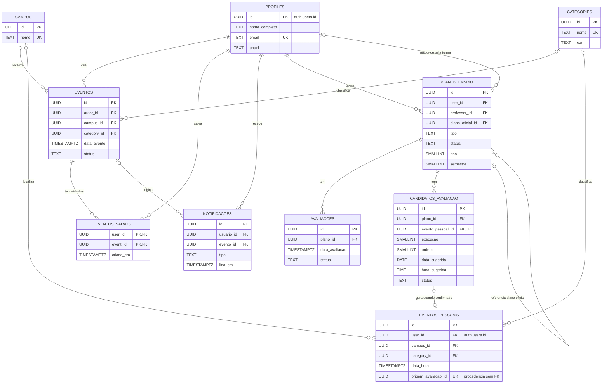

O diagrama mostra as entidades do catálogo, da agenda, da moderação e dos planos de ensino. Consulte colunas, restrições e políticas de acesso na [especificação física](banco-de-dados.md). As tabelas e políticas vigentes são definidas pelas migrações em `supabase/migrations/`. As mudanças planejadas de turmas e versões estão nos [contratos da Release 2](../atualizacoes.md#contratos-da-release-2).

## Diagrama Entidade-Relacionamento (DER)

O dono de `eventos_pessoais` referencia `auth.users.id`. O fluxo de confirmação da API registra a procedência de `avaliacoes` em `eventos_pessoais.origem_avaliacao_id`. Esse campo tem índice único parcial e não é uma chave estrangeira. As tabelas `avaliacoes` e `candidatos_avaliacao` têm contratos diferentes, descritos na [especificação física](banco-de-dados.md).
