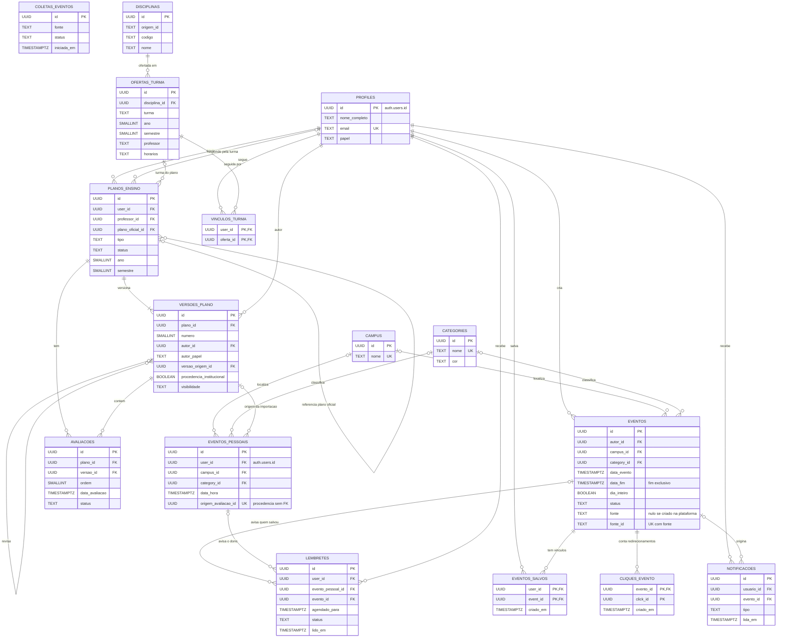

O diagrama mostra as entidades do catálogo, da agenda, da moderação e dos planos de ensino. Consulte colunas, restrições e políticas de acesso na [especificação física](banco-de-dados.md). As tabelas e políticas vigentes são definidas pelas migrações em `supabase/migrations/`. Turmas, vínculos e versões foram modelados na S7-D01 (`20261109120000`), conforme as ADR-009 e ADR-010 e os [contratos da Release 2](../atualizacoes.md#contratos-da-release-2).

## Diagrama Entidade-Relacionamento (DER)

O dono de `eventos_pessoais` referencia `auth.users.id`. O fluxo de confirmação da API registra a procedência em `eventos_pessoais.origem_avaliacao_id` (sem FK) e `origem_versao_id` (FK para `versoes_plano`). A unicidade é por usuário, `(user_id, origem_avaliacao_id)`. `avaliacoes` é a tabela única de candidatos desde a S7-D01; detalhes na [especificação física](banco-de-dados.md).
