O diagrama apresenta todas as entidades ativas do catálogo público, agenda pessoal, moderação, auditoria, catálogo de turmas, planos de ensino, lembretes, integração com Google Agenda e privacidade/ciclo de vida da conta. Consulte colunas, restrições e políticas RLS na [especificação física](/arquitetura/banco-de-dados). O esquema canônico é definido pelas migrações em `supabase/migrations/`.

## Diagrama Entidade-Relacionamento (DER)

```mermaid
erDiagram
    PROFILES {
        UUID id PK "auth.users.id"
        TEXT nome_completo
        TEXT email UK
        TEXT papel
        TEXT avatar_url
    }

    AUDITORIA_PAPEIS {
        BIGINT id PK
        UUID usuario_id FK
        UUID ator_id FK "nulo sem sessao"
        TEXT papel_anterior
        TEXT papel_novo
        TIMESTAMPTZ criado_em
    }

    CAMPUS {
        UUID id PK
        TEXT nome UK
    }

    CATEGORIES {
        UUID id PK
        TEXT nome UK
        TEXT cor
    }

    EVENTOS {
        UUID id PK
        UUID autor_id FK
        UUID campus_id FK
        UUID category_id FK
        TIMESTAMPTZ data_evento
        TIMESTAMPTZ data_fim "fim exclusivo"
        BOOLEAN dia_inteiro
        DATE data_inicio_civil
        DATE data_fim_civil
        TEXT localizacao
        TEXT status
        TEXT fonte "nulo se criado na plataforma"
        TEXT fonte_id "UK com fonte"
        INTEGER interessados_count
    }

    COLETAS_EVENTOS {
        UUID id PK
        TEXT fonte
        TEXT status
        TIMESTAMPTZ iniciada_em
        TIMESTAMPTZ concluida_em
    }

    LEMBRETES {
        UUID id PK
        UUID user_id FK
        TEXT tipo_evento
        UUID evento_pessoal_id FK
        UUID evento_id FK
        TIMESTAMPTZ inicio_referencia
        TIMESTAMPTZ agendado_para
        TEXT status
        TIMESTAMPTZ disparado_em
        TIMESTAMPTZ lido_em
    }

    EVENTOS_PESSOAIS {
        UUID id PK
        UUID user_id FK "auth.users.id"
        UUID campus_id FK
        UUID category_id FK
        TEXT localizacao
        TIMESTAMPTZ data_hora
        TIMESTAMPTZ data_fim
        BOOLEAN dia_inteiro
        UUID origem_avaliacao_id UK "procedencia por usuario"
        UUID origem_versao_id FK
    }

    EVENTOS_SALVOS {
        UUID user_id PK,FK
        UUID event_id PK,FK
        TIMESTAMPTZ criado_em
    }

    CLIQUES_EVENTO {
        UUID evento_id PK,FK
        UUID click_id PK
        TIMESTAMPTZ criado_em
    }

    NOTIFICACOES {
        UUID id PK
        UUID usuario_id FK
        UUID evento_id FK
        TEXT tipo
        TIMESTAMPTZ lida_em
    }

    PLANOS_ENSINO {
        UUID id PK
        UUID user_id FK
        UUID professor_id FK
        UUID oferta_id FK
        UUID plano_oficial_id FK
        UUID versao_aprovada_id FK
        TEXT tipo
        TEXT status
        SMALLINT ano
        SMALLINT semestre
    }

    AVALIACOES {
        UUID id PK
        UUID plano_id FK
        UUID versao_id FK
        SMALLINT ordem
        TIMESTAMPTZ data_avaliacao
        DATE data_sugerida
        TIME hora_sugerida
        TEXT status
    }

    VERSOES_PLANO {
        UUID id PK
        UUID plano_id FK
        SMALLINT numero
        UUID autor_id FK
        TEXT autor_papel
        UUID versao_origem_id FK
        BOOLEAN procedencia_institucional
        TEXT fonte_institucional_url
        TEXT visibilidade
    }

    VOTOS_AVALIACAO {
        UUID user_id PK,FK
        UUID avaliacao_id PK,FK
        TEXT valor
    }

    OPERACOES_IMPORTACAO {
        UUID id PK
        UUID user_id FK
        TEXT chave "UK com user_id"
        UUID versao_id FK
    }

    ITENS_IMPORTACAO {
        UUID operacao_id PK,FK
        UUID avaliacao_id PK
        UUID evento_pessoal_id FK "nulo se evento apagado"
        TEXT resultado
        TEXT tipo_revisado
    }

    DISCIPLINAS {
        UUID id PK
        TEXT origem
        TEXT origem_id
        TEXT codigo
        TEXT nome
        TEXT unidade
        TEXT nivel
    }

    OFERTAS_TURMA {
        UUID id PK
        UUID disciplina_id FK
        UUID publicacao_id FK
        TEXT turma
        SMALLINT ano
        SMALLINT semestre
        TEXT professor
        TEXT horarios
    }

    SINCRONIZACOES_CATALOGO {
        UUID id PK
        TEXT origem
        TEXT status
        TIMESTAMPTZ iniciada_em
        TIMESTAMPTZ concluida_em
    }

    VINCULOS_TURMA {
        UUID user_id PK,FK
        UUID oferta_id PK,FK
        TEXT origem
    }

    GOOGLE_CALENDAR_OAUTH_STATES {
        TEXT state_hash PK
        UUID user_id FK
        TEXT agenda_email
        TIMESTAMPTZ expires_at
    }

    GOOGLE_CALENDAR_CONNECTIONS {
        UUID user_id PK,FK
        TEXT google_sub UK
        TEXT google_email
        TEXT calendar_id
    }

    GOOGLE_CALENDAR_EVENT_EXPORTS {
        UUID user_id PK,FK
        TEXT event_kind PK
        UUID local_event_id PK
        TEXT calendar_id
        TEXT google_event_id
        TEXT exported_version
        TEXT status
    }

    ACEITES_TERMOS {
        UUID user_id PK,FK
        TEXT documento PK
        TEXT versao PK
        TIMESTAMPTZ aceito_em
    }

    CONSENTIMENTOS {
        UUID id PK
        UUID user_id FK
        TEXT finalidade
        TIMESTAMPTZ concedido_em
        TIMESTAMPTZ revogado_em
    }

    EXCLUSOES_CONTA {
        UUID id PK
        TEXT status
        TIMESTAMPTZ iniciada_em
        TIMESTAMPTZ concluida_em
        INTEGER planos_removidos
        INTEGER eventos_pessoais_removidos
        INTEGER eventos_publicos_removidos
        INTEGER arquivos_storage_removidos
    }

    PROFILES ||--o{ AUDITORIA_PAPEIS : "audita mudancas"
    PROFILES ||--o{ EVENTOS : "cria"
    PROFILES ||--o{ EVENTOS_SALVOS : "salva"
    PROFILES ||--o{ NOTIFICACOES : "recebe"
    PROFILES ||--o{ PLANOS_ENSINO : "envia"
    PROFILES o|--o{ PLANOS_ENSINO : "responde pela turma"
    CAMPUS o|--o{ EVENTOS : "localiza"
    CAMPUS o|--o{ EVENTOS_PESSOAIS : "localiza"
    CATEGORIES o|--o{ EVENTOS : "classifica"
    CATEGORIES o|--o{ EVENTOS_PESSOAIS : "classifica"
    EVENTOS ||--o{ EVENTOS_SALVOS : "tem vinculos"
    EVENTOS o|--o{ LEMBRETES : "avisa quem salvou"
    EVENTOS_PESSOAIS o|--o{ LEMBRETES : "avisa o dono"
    PROFILES ||--o{ LEMBRETES : "recebe"
    EVENTOS o|--o{ NOTIFICACOES : "origina"
    EVENTOS ||--o{ CLIQUES_EVENTO : "conta redirecionamentos"
    PLANOS_ENSINO ||--o{ AVALIACOES : "tem"
    PLANOS_ENSINO ||--|{ VERSOES_PLANO : "versiona"
    VERSOES_PLANO ||--o{ AVALIACOES : "contem"
    VERSOES_PLANO o|--o{ VERSOES_PLANO : "revisa"
    PROFILES ||--o{ VERSOES_PLANO : "autor"
    DISCIPLINAS ||--o{ OFERTAS_TURMA : "ofertada em"
    SINCRONIZACOES_CATALOGO o|--o{ OFERTAS_TURMA : "publica"
    OFERTAS_TURMA o|--o{ PLANOS_ENSINO : "turma do plano"
    PROFILES ||--o{ VINCULOS_TURMA : "segue"
    OFERTAS_TURMA ||--o{ VINCULOS_TURMA : "seguida por"
    PLANOS_ENSINO o|--o{ PLANOS_ENSINO : "referencia plano oficial"
    VERSOES_PLANO o|--o{ EVENTOS_PESSOAIS : "origem da importacao"
    AVALIACOES ||--o{ VOTOS_AVALIACAO : "recebe"
    PROFILES ||--o{ VOTOS_AVALIACAO : "vota"
    PROFILES ||--o{ OPERACOES_IMPORTACAO : "confirma"
    OPERACOES_IMPORTACAO ||--|{ ITENS_IMPORTACAO : "contem"
    EVENTOS_PESSOAIS o|--o{ ITENS_IMPORTACAO : "criado por"
    PROFILES ||--o{ GOOGLE_CALENDAR_OAUTH_STATES : "inicia OAuth"
    PROFILES ||--o| GOOGLE_CALENDAR_CONNECTIONS : "conecta Google Agenda"
    PROFILES ||--o{ GOOGLE_CALENDAR_EVENT_EXPORTS : "mapeia exportacoes"
    PROFILES ||--o{ ACEITES_TERMOS : "aceita documentos legais"
    PROFILES ||--o{ CONSENTIMENTOS : "concede ou revoga"
```

## Observações estruturais

- O dono de `eventos_pessoais` referencia `auth.users.id` (`ON DELETE CASCADE`). A procedência de importação de avaliações é registrada em `eventos_pessoais.origem_avaliacao_id` (sem chave estrangeira) e `origem_versao_id` (FK para `versoes_plano`, `ON DELETE SET NULL`), com unicidade por usuário em `(user_id, origem_avaliacao_id)`.
- A tabela `avaliacoes` é a estrutura física unificada dos candidatos extraídos dos planos. A tabela `exclusoes_conta` armazena exclusivamente contagens agregadas sem `user_id` nem dados pessoais.
- As tabelas transitórias `candidatos_avaliacao`, `fila_processamento_ia` e `eventos_cliques_redirecionamento` foram removidas do esquema; o processamento de planos utiliza o lease diretamente em `planos_ensino` e a deduplicação de redirecionamentos utiliza `cliques_evento`.

## Exceções de nomenclatura preservadas {#excecoes-de-nomenclatura}

Por compatibilidade com as migrações iniciais e contratos de cliente, o esquema físico preserva as seguintes exceções ao padrão geral descrito em [Padrões do projeto](/produto/padroes):

- **Nomes de tabelas e colunas em inglês:** `profiles`, `categories`, `user_id`, `professor_id`, `category_id` e `event_id` (além das colunas técnicas OAuth `state_hash`, `agenda_email`, `encrypted_code_verifier`, `expires_at`, `google_sub`, `google_email`, `calendar_id`, `encrypted_access_token`, `encrypted_refresh_token`, `access_token_expires_at`, `granted_scope`, `event_kind`, `local_event_id`, `google_event_id`, `exported_version`, `status`, `last_idempotency_key`).
- **Mapeamentos distintos para o instante de início:** `eventos.data_evento` e `eventos_pessoais.data_hora`.
- **Valores de estado em português no banco:** estados como `pendente`, `processando`, `concluido`, `falha`, `aprovado`, `rejeitado`, `confirmado`, `descartado`, `privada` e `compartilhada` convivem com chaves JSON em inglês expostas nos contratos HTTP da API.
