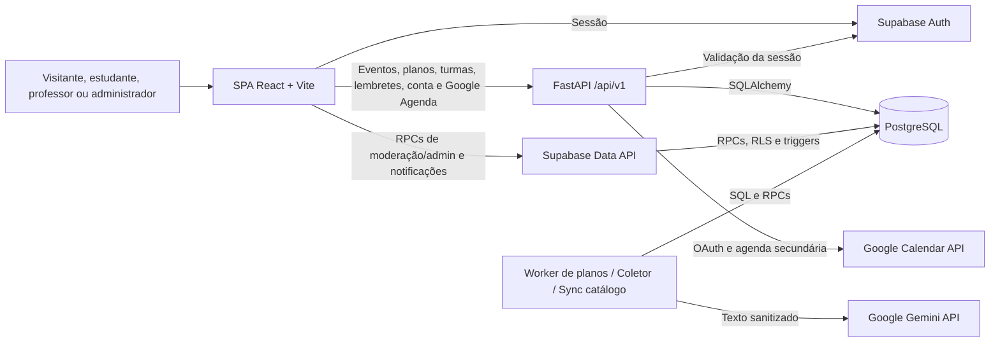
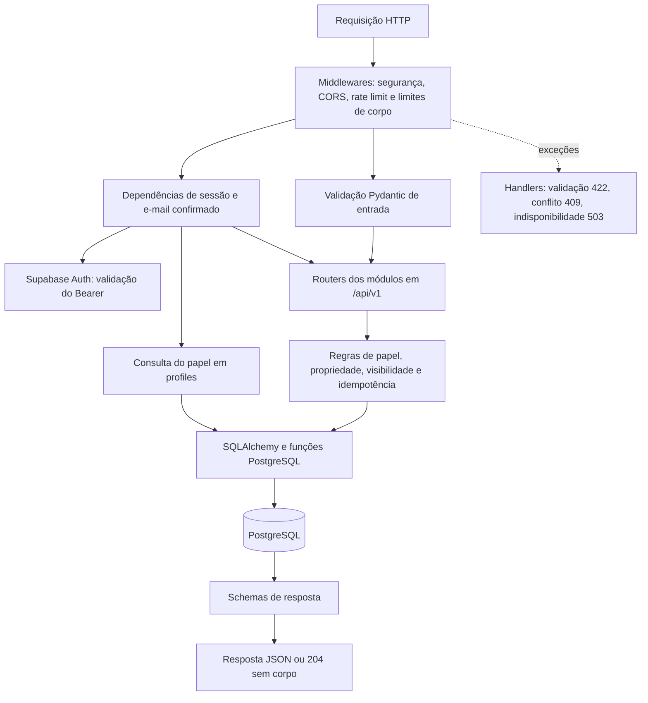

## 1. Objetivo e escopo

O Agenda UnB reúne eventos públicos dos campi da UnB e compromissos privados em uma aplicação web responsiva. A plataforma integra catálogo público de eventos, agenda pessoal unificada, coleta institucional da Agenda UnB Notícias, catálogo público de turmas (Followw) com vínculo autodeclarado, extração assistida de planos de ensino com versionamento e biblioteca compartilhada, lembretes persistentes, exportação para Google Agenda e `.ics`, além de gestão de conta, consentimentos e privacidade. Matrícula oficial, notas e frequência seguem no sistema acadêmico institucional.

## 2. Visão geral

A comunicação segue dois caminhos complementares: recursos de negócio (eventos, agenda pessoal, vínculos salvos, catálogo de turmas, planos de ensino, lembretes, conta/privacidade e Google Agenda) usam a API FastAPI; autenticação, leitura de perfis, notificações de moderação e RPCs administrativas usam o SDK Supabase no navegador. As RPCs e políticas RLS conferem o papel e a confirmação de e-mail diretamente no banco; os guards das rotas React atuam apenas como controle de navegação.

## 3. Stack e organização {#3-stack-e-organizacao}

| Camada | Tecnologia e localização |
| --- | --- |
| Frontend | React 19, Vite 6, React Router 7; `frontend/src/` |
| API | Python 3.11, FastAPI, SQLAlchemy 2, Pydantic 2 e httpx; `backend/src/` |
| Dados e sessão | PostgreSQL via Supabase, Supabase Auth, Supabase Cron (`pg_cron`) e SDK JavaScript |
| Migrações | SQL versionado em `supabase/migrations/` e aplicado em ordem cronológica |
| Jobs assíncronos | Worker de planos (`syllabus/worker.py`), coletor institucional (`events/collector.py`) e sincronizador do catálogo (`classes/sync.py`) |
| Documentação | Markdown compartilhado publicado via Mintlify (`docs/docs.json`) |
| Testes e CI | `pytest` em `backend/tests/`, `node --test` e Playwright em `frontend/`, workflows `.github/workflows/` |

A API é uma aplicação FastAPI única, organizada em seis módulos sob `backend/src/modules/` (`account`, `classes`, `events`, `google_calendar`, `reminders` e `syllabus`), registrados em `backend/src/main.py`. `backend/src/database/models.py` mapeia as tabelas usadas pela API; as migrações em `supabase/migrations/` constituem a referência completa de tabelas, restrições, índices, triggers, funções e políticas RLS.

## 4. Frontend e navegação {#4-frontend-e-navegacao}

| Rota | Comportamento |
| --- | --- |
| `/` | Apresentação institucional, cadastro e login |
| `/auth/retorno` | Retorno PKCE de confirmação de e-mail, recuperação de senha e login OAuth |
| `/eventos` | Catálogo público e Meus Eventos; lista de cards ou calendário mensal/semanal, lembretes e exportação Google Agenda / `.ics` |
| `/evento/:id` | Detalhes de evento público aprovado ou compromisso privado do proprietário, com procedência e redirecionamento **Conferir evento** |
| `/plano-de-ensino` | Fluxo em duas etapas: seleção de turmas no catálogo e organização de datas (envio de PDF/texto sanitizado, acompanhamento da extração, revisão em lote e biblioteca compartilhada da turma) |
| `/configuracoes` | Aceite de documentos legais vigentes, gestão/revogação de consentimentos opcionais, exportação de dados em JSON e exclusão da conta |
| `/sugestoes` | Fila e histórico de sugestões da comunidade e revisões de coleta institucional; professores e administradores |
| `/admin` | Busca e filtros de usuários, confirmação de e-mail, último acesso, atribuição de cargos e gestão de categorias; somente administradores |
| `/segunda-pagina` | Redirecionamento legado para `/eventos`, preservando query e fragmento (`#plano-de-ensino` leva a `/plano-de-ensino`) |
| `/privacidade.html`, `/termos.html` | Páginas públicas estáticas geradas a partir de `docs/produto/` |

O calendário utiliza os mesmos eventos filtrados da lista, com navegação por mês/semana, botão **Hoje** e horários ordenados por dia, com rolagem horizontal em telas pequenas. As datas seguem a semântica de instantes e datas civis com fim exclusivo em `America/Sao_Paulo` ([ADR-011](/arquitetura/adrs/adr-011-datas-civis-e-instantes)).

**Meus Eventos** combina compromissos privados (`eventos_pessoais`) com vínculos a eventos públicos salvos (`eventos_salvos`). Os dados de eventos públicos são lidos do registro original aprovado; remover o vínculo cancela lembretes pendentes associados sem alterar o evento público. Somente compromissos privados podem ser editados nessa agenda.

## 5. API REST implementada {#5-api-rest-implementada}

As rotas de negócio usam o prefixo `/api/v1`; rotas autenticadas exigem `Authorization: Bearer <token>` emitido pelo Supabase Auth e e-mail confirmado. O middleware (`backend/src/middlewares/auth.py`) valida o token junto ao Supabase Auth e consulta o papel persistido em `profiles`.

O [inventário da API](/api-specs) detalha todas as operações HTTP de eventos públicos, agenda pessoal, sugestões, vínculos salvos, catálogo de turmas, planos de ensino e versões compartilhadas, lembretes, conta/privacidade, Google Agenda e saúde (`/health` e `/api/health`).

### Fluxo interno do backend

Rotas públicas dispensam a validação de sessão. `get_db` gerencia a abertura e o fechamento da sessão de banco por requisição; as rotas e serviços controlam as transações. A verificação de papel e propriedade na API permanece obrigatória mesmo quando a conexão PostgreSQL ignora RLS.

## 6. Sugestões, moderação, notificações e administração

Estudantes submetem propostas pela rota `POST /api/v1/suggestions`. O banco força a autoria da sessão e o status `pendente`, registrando a origem estudantil (`sugestao_estudante`) de forma preservada mesmo após eventual alteração de cargo.

O frontend utiliza as seguintes RPCs pelo SDK Supabase (`frontend/src/lib/moderation.js`):

| RPC | Responsabilidade e acesso |
| --- | --- |
| `listar_sugestoes` | Pendentes e histórico aprovado/rejeitado, busca e paginação de 20; professor/admin |
| `listar_revisoes_coleta` | Itens coletados da Agenda UnB Notícias em revisão, com paginação de 20; professor/admin |
| `moderar_sugestao` | Decide sugestões ou itens coletados pendentes; professor/admin; recusa exige justificativa de até 2.000 caracteres |
| `admin_buscar_usuarios` | Busca por nome/e-mail, filtros de papel e confirmação, último acesso e paginação de 20; admin |
| `admin_definir_papel` | Verifica cargo anterior, registra auditoria e altera papel via `admin_alterar_papel`; somente admin |
| `admin_listar_categorias` | Lista categorias com contagem de eventos vinculados; somente admin |
| `admin_criar_categoria` | Cria categoria com nome e cor hexadecimal; somente admin |
| `admin_excluir_categoria` | Remove categoria sem eventos vinculados; somente admin |

Decisões concorrentes de moderação não sobrescrevem decisões anteriores. Alterações de papel detectam divergência do cargo esperado, impedem que administradores removam o próprio cargo e gravam histórico em `auditoria_papeis`.

Triggers registram notificações de submissão, aprovação e recusa na tabela `notificacoes` na mesma transação do evento. O componente `NotificationBell` é exibido a todas as contas autenticadas para consulta de lembretes (`GET /api/v1/me/reminders`) e apresenta a aba **Sugestões** para estudantes.

## 7. Persistência, privacidade, coleta e implantação {#7-persistencia-privacidade-e-migracoes}

O esquema completo, suas colunas, índices, triggers e políticas RLS estão descritos no [modelo de dados](/arquitetura/modelo-de-dados) e na [especificação do banco](/arquitetura/banco-de-dados). Entre as garantias transversais:

- **Isolamento de dados privados:** compromissos pessoais (incluindo `localizacao`), vínculos salvos, lembretes, planos privados, aceites legais, consentimentos e credenciais OAuth do Google Agenda são isolados por usuário autenticado com e-mail confirmado.
- **Domínio institucional:** cadastro e autopromoção para `professor` exigem e-mail `@unb.br` confirmado; administradores podem atribuir papel docente a contas confirmadas pela RPC administrativa.
- **Minimização em planos de ensino:** o backend extrai e sanitiza o texto localmente em memória, descarta o PDF original imediatamente (sem gravação em Storage e com `filePath: null`), autoriza apenas o snapshot sanitizado via hash SHA-256 e executa o worker assíncrono sobre `planos_ensino` com lease, fencing e orçamento controlado.
- **Coleta e catálogo desacoplados:** o coletor de eventos (`https://noticias.unb.br`, respeitando `robots.txt`) e o sincronizador do catálogo de turmas (`https://followw.app/api`) operam fora das requisições HTTP da agenda, preservando dados existentes e decisões locais em caso de falha da fonte externa.
- **Hospedagem e CI/CD:** a SPA é publicada na Vercel (`frontend/vercel.json`), a API FastAPI em container Docker (`backend/Dockerfile`, Python 3.11) no Render (`render.yaml`), o banco/Auth/Cron no Supabase gerenciado e os jobs agendados e validações de CI no GitHub Actions (`.github/workflows/`). Consulte o [plano de implantação](/implantacao).

## 8. Verificação {#8-verificacao}

- **Backend (SQLite e PostgreSQL local):** `cd backend && python -m pytest tests -q -ra` executa a suíte de API e unidade; testes de RLS, triggers e RPCs (`tests/*_database.py` e `tests/test_syllabus_http_integration.py`) exigem Supabase local descartável com `TEST_SUPABASE_DB_URL` apontando para `localhost`/`127.0.0.1`, além de `supabase db lint --level error --fail-on error`.
- **Frontend:** `cd frontend && npm test` executa os testes Node (`src/lib/*.test.js`), `npm run build` valida o bundle Vite e geração de busca, e `npx playwright test` executa os cenários ponta a ponta.
- **Documentação:** `npx -y mint validate`, `npx -y mint broken-links --check-redirects` e `npx -y mint a11y` em `docs/` validam sintaxe, links e acessibilidade.

Consulte [Contribuição](/processo/contribuindo) para o fluxo completo de execução e validação.

## 9. Registro de decisões arquiteturais {#9-registro-de-decisoes-arquiteturais}

O [índice de ADRs](/arquitetura/adrs/index) reúne todas as decisões arquiteturais (`ADR-001` a `ADR-014`), com rastreabilidade aos identificadores `DA-01` a `DA-07` e aos requisitos funcionais e não funcionais.

| Registro inicial | ADR correspondente |
| --- | --- |
| DA-01 — aplicação única | [ADR-004](/arquitetura/adrs/adr-004-api-monolitica) |
| DA-02 — integração FastAPI/Supabase | [ADR-001](/arquitetura/adrs/adr-001-integracao-fastapi-supabase) |
| DA-03 — sessão e papel | [ADR-005](/arquitetura/adrs/adr-005-validacao-de-sessao) |
| DA-04 — autorização | [ADR-006](/arquitetura/adrs/adr-006-autorizacao-em-camadas) |
| DA-05 — migrações | [ADR-007](/arquitetura/adrs/adr-007-migracoes-sql) |
| DA-06 — eventos salvos | [ADR-008](/arquitetura/adrs/adr-008-vinculos-de-eventos-publicos) |
| DA-07 — hospedagem | [ADR-002](/arquitetura/adrs/adr-002-separar-hospedagem-e-ambientes) |

## 10. Matriz de regras e evidências {#10-matriz-de-regras-e-evidencias}

Os arquivos de teste indicados abaixo são relativos a `backend/tests/`.

| Regra de negócio e segurança | Onde é aplicada | Cobertura de referência |
| --- | --- | --- |
| Catálogo e salvos exibem somente aprovados | Consultas do router e RLS | `test_events_api.py`, `test_saved_events_api.py` |
| Privados e vínculos são acessíveis somente pelo dono | Filtro `user_id` na API e RLS SQL | `test_events_api.py`, `test_saved_events_api.py` |
| Só professor/admin publicam e excluem públicos | `require_event_manager` e RLS | `test_events_api.py`, `test_moderation_database.py` |
| Sugestão estudantil nasce pendente sem autoria forjada | Router e triggers SQL | `test_suggestions_api.py`, `test_moderation_database.py` |
| Moderação e revisão de coleta somente em pendentes | `moderar_sugestao` e `listar_revisoes_coleta` | `test_moderation_database.py`, `test_event_collection_database.py` |
| Admin altera terceiros, sem autorrebaixamento, com auditoria | `admin_definir_papel`, `auditoria_papeis` | `test_moderation_database.py`, `test_security_database.py` |
| Cadastro/autopromoção professor exige `@unb.br` confirmado | Triggers de perfil e papel | `test_moderation_database.py`, `test_security_database.py` |
| Minimização, fila com lease e confirmação idempotente de planos | `syllabus/worker.py`, `confirmar_importacao`, RLS | `test_syllabus_processing.py`, `test_syllabus_database.py`, `test_plan_import_database.py`, `test_plan_sharing_database.py` |
| Lembretes automáticos 24 h antes e leitura isolada | Triggers em `lembretes` e `disparar_lembretes` | `test_reminders_api.py`, `test_reminders_database.py` |
| Exportação Google Agenda idempotente e aceites/exclusão de conta | `google_calendar/`, `account/`, `aceites_termos` | `test_google_calendar_api.py`, `test_account_privacy_api.py`, `test_account_privacy_database.py` |
