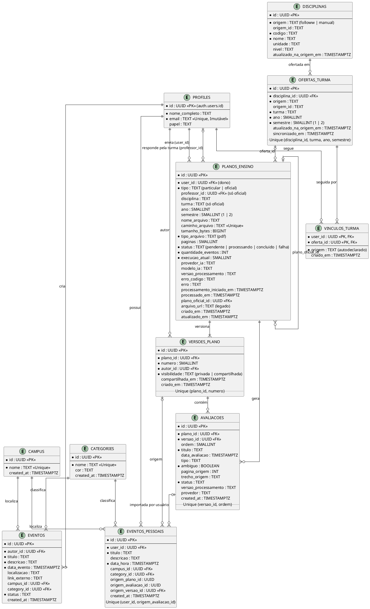

# Arquitetura de Dados - Agenda UnB

Este documento apresenta a estrutura visual de dados adotada no banco de dados Supabase do MVP da Agenda UnB. Ele inclui o Diagrama Entidade-Relacionamento (DER) para visualização da arquitetura, descrevendo como as tabelas interagem. O Dicionário de Dados detalhado (DDL) encontra-se no documento `modelo_fisico.md`.

---

## 1. Diagrama Entidade-Relacionamento (DER)

O diagrama abaixo ilustra as relações entre as tabelas centrais do banco de dados. As tabelas `eventos_salvos` e `notificacoes` estão descritas em [Especificação do Banco](especificacao-banco-de-dados.md) e em [Painel administrativo](painel-administrativo.md).

---

