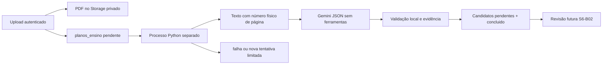

# Processamento privado de planos de ensino — S6-B01

Implementação de RF06/RNF06 para planos particulares em PDF com texto selecionável.
O processamento gera **candidatos**, nunca compromissos, notificações ou registros
na tabela legada `avaliacoes`. Consulta/revisão de candidatos e confirmação na
agenda pertencem à S6-B02/S6-D02 e não são implementadas aqui.

## Dependências e limite de ativação

- #40: upload autenticado, PDF válido, Storage privado e registro `pendente`.
- S6-D01: migração `20261027120000`, candidatos, procedência e estados em português.
- S6-B01: migração `20261109120000_fila_processamento_planos.sql` para lease,
  próxima tentativa, orçamento acumulado e duração.
- **S6-D02 ainda não está nesta cópia do repositório.** Antes de usar dados reais,
  aplicar e testar as políticas de planos/candidatos/Storage, impedir escrita do
  cliente sobre estado/lease/orçamento e corrigir a leitura pública de avaliações.
  Testar dono, outro estudante, professor, `anon` e `authenticated` no PostgreSQL.

O worker nasce desativado. `SYLLABUS_PRIVACY_READY=true` é uma declaração operacional
de que as políticas foram implantadas e verificadas, não substitui esses testes.
Não ativar essa configuração apenas porque a chave Gemini funciona.

## Arquitetura e recuperação



A API não inicia threads, `BackgroundTasks` ou chamadas à IA. A própria linha de
`planos_ensino` é a fila persistente; reiniciar API/worker não perde a tarefa.
O worker consulta a fila a cada segundo quando ocioso. Em PostgreSQL, usa
`FOR UPDATE SKIP LOCKED` para reivindicar uma linha, incrementa `execucao_atual`,
reserva custo e grava `processando` com um UUID `token_processamento` antes de
liberar a transação. O UUID impede que um processo antigo finalize o trabalho
depois de outro assumir a linha.

Um lease expira após 90 segundos sem conclusão. Outra execução recupera a linha,
consumindo uma das tentativas limitadas e preservando a reserva anterior. A última
tentativa interrompida termina em `falha`, sem repetir indefinidamente. Uma
interrupção pode causar nova cobrança pelo provedor: não se promete execução
externa exatamente uma vez.

Cada tentativa roda em um subprocesso `spawn`, com prazo total padrão de 18s
para Storage, extração do PDF e resposta da IA. O processo pai mantém as transações
da fila; se a tentativa travar, encerra o subprocesso, preserva a reserva e grava
`tempo_esgotado` (ou reagenda dentro do limite). A limpeza do processo leva até
mais 2,2s. O prazo deve ser menor que o lease. Somente JSON validado ou um código
fixo cruza o pipe; dados do PDF e resposta bruta não são registrados em arquivos.

Candidatos e `concluido` são gravados na mesma transação; falha na persistência
desfaz ambos. Uma conclusão não volta para a fila. A unicidade
`(plano_id, execucao, ordem)` protege a gravação e a validação remove itens
duplicados na resposta. Não há reprocessamento manual nesta entrega.

## Provedor, modelo e orçamento

Provedor: **Google Gemini API**, modelo padrão **`gemini-3.5-flash-lite`**, via REST
Interactions API (`v1beta`, revisão `2026-05-20`). REST usa o `httpx` já existente;
não é necessário instalar CLI nem outro SDK. Não há fallback silencioso de modelo.
Referências: [texto](https://aistudio.google.com/docs/text-generation),
[JSON estruturado](https://aistudio.google.com/docs/structured-output) e
[preços](https://aistudio.google.com/docs/pricing#gemini-3.5-flash-lite), consultadas
em 09/11/2026.

| Configuração do servidor | Padrão | Regra |
| --- | --- | --- |
| `GEMINI_API_KEY` | Ausente | Segredo no ambiente do backend/worker, nunca `VITE_` |
| `GEMINI_MODEL` | `gemini-3.5-flash-lite` | Alterar junto aos preços e à avaliação do corpus |
| `SYLLABUS_AI_TIMEOUT_SECONDS` | 12 | Timeout de rede por operação e verificação de tempo ao receber resposta; máximo 30 |
| `SYLLABUS_ATTEMPT_TIMEOUT_SECONDS` | 18 | Prazo total do subprocesso (Storage, PDF e IA); máximo 60, sempre menor que o lease |
| `SYLLABUS_MAX_ATTEMPTS` | 2 | Total por arquivo, inclusive recuperação após interrupção; máximo 3 |
| `SYLLABUS_MAX_FILE_COST_USD` | 0,06 | Teto conservador acumulado por arquivo |
| `GEMINI_INPUT_USD_PER_MILLION` | 0,30 | USD por 1 milhão de tokens de entrada |
| `GEMINI_OUTPUT_USD_PER_MILLION` | 2,50 | USD por 1 milhão de tokens, incluindo raciocínio |
| `SYLLABUS_WORKER_ENABLED` | false | Habilitação explícita do processo |
| `SYLLABUS_PRIVACY_READY` | false | Só habilitar depois da S6-D02 e dos testes de acesso |

Limites internos: 10 MB, dez páginas, 40.000 bytes de texto UTF-8, 4.096 tokens de
saída, até 100 candidatos e resposta de até 256 KB. Documentos mais densos devem
ser reduzidos ou cadastrados manualmente; não se corta silenciosamente o texto.

Antes de cada tentativa, reservar:

`((40000 + 16000) × preço_entrada + 4096 × preço_saída) / 1000000`.

Com os padrões, são **USD 0,027040 por tentativa**, no máximo USD 0,054080 em duas.
O envelope real é conferido contra o limite de entrada; há margem de 16.000 bytes
para instrução, esquema e JSON. A estimativa usa bytes como limite conservador de
tokens de texto, sem imagens/ferramentas. A reserva **não é cobrança medida** e
continua consumida após timeout, erro ou interrupção, porque o provedor pode ter
cobrado. Se não houver orçamento restante, o arquivo falha antes de nova chamada.
Revisar preços no provedor ao mudar modelo/tarifa; não extrapolar essa garantia a
ferramentas ou modalidades novas. O tier gratuito não é pressuposto no orçamento.

429, 5xx selecionados, timeout e falha de conexão permitem nova tentativa, após
dois segundos; erros de autenticação, resposta inválida ou PDF inválido não.
A fila persiste as tentativas; reiniciar o processo não reinicia esse limite.
Falhas persistidas usam exclusivamente os códigos da S6-D01 e mensagens fixas.
HTTP bruto, exceções SQL com parâmetros e respostas da IA não viram mensagens
para o estudante.

## Validação e privacidade

- Cada página tem numeração física iniciada em 1. O PDF é lido do caminho privado
  do dono; não se aceitam URLs retornadas pela IA ou caminhos de outros usuários.
- O Gemini recebe JSON de páginas como dados não confiáveis, separado da instrução
  do sistema. Não recebe chave no prompt, ferramentas, busca, URLs de Storage ou
  poderes de execução. `store=false` desativa persistência de Interactions; isso
  **não substitui** a análise dos termos de tratamento de dados do provedor para o
  tier contratado. Dados reais continuam bloqueados pela dependência S6-D02.
- O esquema enviado à API é simplificado para o decodificador do provedor. O
  Pydantic local mantém todas as restrições, rejeita campos extras, tipos/datas
  inválidos, páginas inexistentes e trechos que não aparecem na página citada.
- Título é literal do trecho. Tipo vem da lista da S6-D01. Data exige dia/mês/ano
  completos e inequívocos no próprio trecho. Não se completa ano usando o relógio
  ou semestre. ISO, `dd/mm/aaaa`, `dd-mm-aaaa` e mês por extenso são reconhecidos.
- Datas sem evidência são removidas e marcadas como ambíguas; horas também precisam
  aparecer no trecho e dependem de data válida, conforme a constraint da S6-D01.
  Ausência de horário permanece nula, sem assumir meia-noite. Hora é local, sem
  fuso: a confirmação futura deverá exigir o fuso explícito do estudante.
  Dois horários distintos no mesmo trecho (alternativa ou intervalo) deixam a
  hora nula e ambígua; o servidor não escolhe o início de um intervalo. Horários
  que o próprio modelo declarou incertos também precisam de revisão.
- Documento sem cronograma conclui com zero candidatos. JSON malformado, saída
  truncada ou evidência inválida causam `falha`, sem persistência parcial.
- Logs próprios contêm apenas contagens, códigos, duração e indicador de desvio
  de 20s. Não habilitar logs HTTP com corpos/headers nem `echo=True` do SQLAlchemy;
  PDFs, texto integral, chaves e resposta bruta não devem ir para logs/APM.

## Operação por ambiente

Em desenvolvimento, usar Supabase local e somente PDFs sintéticos. Em homologação,
usar projeto, bucket e chave Gemini exclusivos, ainda com dados sintéticos. Em
produção, aplicar as políticas S6-D02 e verificar seus testes antes da ativação;
segredos ficam no runtime do servidor ou gerenciador de segredos da hospedagem.
Não há alteração automática de `.env`, migração remota ou implantação nesta entrega.

Depois dos pré-requisitos, executar em um terminal/processo independente, na pasta
`backend`, com o mesmo banco/Storage da API:

```bash
python -m src.modules.syllabus.worker
# Para consumir no máximo um item:
python -m src.modules.syllabus.worker --once
```

Em hospedagem, configurar processo de worker com reinício automático e acesso de
servidor ao PostgreSQL/Storage. API e worker compartilham a fila, não a memória.
O Storage em memória só serve aos testes; o comando de produção o rejeita.
A consulta autenticada existente `GET /api/v1/syllabus/{id}` permite polling
do estado; resposta não contém candidatos ou credenciais. Ver [API](api-specs.md).

## Avaliação reproduzível

O corpus `backend/tests/fixtures/syllabus/cases.json` é inteiramente sintético,
sem nomes, matrículas ou PDFs reais. Inclui cronograma completo, documento sem
cronograma, ano/data ausentes, dez páginas com texto adicional e tentativa de
instrução maliciosa. PDFs são montados em memória com referências de página.

Na pasta `backend`:

```bash
python -m pytest tests -q
python scripts/benchmark_syllabus.py --output ../docs/benchmarks/syllabus-reference-2026-11-09.json
# Faz chamadas reais ao provedor, exclusivamente com o corpus sintético:
python scripts/benchmark_syllabus.py --live --output ../docs/benchmarks/syllabus-gemini-2026-11-09.json
```

O script não aceita arquivos arbitrários. A avaliação compara avaliações associadas
por nome literal e página com o gabarito: título pode incluir um sufixo literal;
tipo, data e hora precisam coincidir. Registra acertos, omissões, divergências,
extras, datas inventadas persistidas e datas sem evidência bloqueadas pela validação.
Falhas de arquivo também são contadas e não equivalem a sucesso rápido.

A duração total inclui geração/leitura do PDF, criação/limpeza do subprocesso,
chamada real, validação e transação
no SQLite local. Storage e despacho de fila são simulados e imediatos; não inclui
download remoto, fila congestionada ou latência PostgreSQL/Supabase. Portanto,
medir menos de 20s no corpus não homologa o RNF06 em produção. Retentativas e
recuperações podem exceder a meta e precisam ser registradas, não ocultadas.

Os [resultados com Gemini](benchmarks/syllabus-gemini-2026-11-09.json) e a
[referência sem rede](benchmarks/syllabus-reference-2026-11-09.json) registram a
execução desta entrega. O teste PostgreSQL opt-in exige `TEST_SUPABASE_DB_URL`
local com todas as migrações; ele verifica constraints/tipos e transação, não as
políticas S6-D02 ainda pendentes.

### Resultado de 09/11/2026 — `syllabus-v2`, com subprocessos

| Caso | Páginas | Acertos/esperados | Tempo total | Desvio de 20s |
| --- | --- | --- | --- | --- |
| Cronograma completo | 1 | 2/2 | 6,933s | Não |
| Sem cronograma | 2 | 0/0 (vazio concluído) | 5,028s | Não |
| Datas ausentes | 1 | 2/2 (datas nulas) | 4,873s | Não |
| Documento denso | 10 | 2/2 | 5,171s | Não |
| Instrução maliciosa | 2 | 1/1 | 4,707s | Não |

Total: sete acertos, zero omissões, divergências, extras, falhas ou datas inventadas
persistidas. Nenhuma data precisou ser bloqueada nessa execução; os testes
adversariais locais verificam a remoção de datas sem evidência. A amostra é pequena
e sintética; não representa todos os formatos de cronograma da UnB nem comprova
resistência geral a instruções maliciosas.
